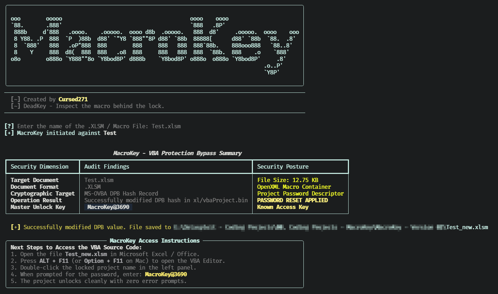

<div align="center">

  

  <h1>MacroKey</h1>

  <p align="center">
    
  </p>

  <p align="center">
    
    
    
    
    <a href="./LICENSE">
      
    </a>
  </p>

  <p>Inspect the Macro Behind the Lock.</p>

</div>


## Overview

MacroKey is a Python utility for authorized inspection and security research involving macro-enabled Microsoft Office documents.

It examines supported OpenXML macro containers for an embedded `vbaProject.bin`, identifies an active VBA project-protection descriptor, and writes a modified copy of the original archive to a separate output file. The original input document is not altered.

> MacroKey is intended for authorized malware analysis, incident response, forensic review, and security research. Do not use it to access, modify, or redistribute a document or VBA project without explicit authorization from its owner.

## Features

| Capability | What it does |
| :--- | :--- |
| Macro-container validation | Confirms that the supplied file is a valid ZIP-based OpenXML archive. |
| VBA project discovery | Searches known Office paths for `vbaProject.bin` and falls back to a recursive filename search. |
| Protection-record inspection | Searches the VBA project data for the `DPB` protection-record structure. |
| Non-destructive processing | Reads the source archive and writes a new output document; the original file remains unchanged. |
| Configurable destination | Lets the operator choose the output filename and location. |
| Terminal summary | Reports the target document, format, cryptographic target, operation result, and output path. |
| Temporary rebuild | Rebuilds the archive in a temporary directory before copying it to the final destination. |

## Screenshots:

### Interface


## Supported Formats

| Format | Typical VBA project path |
| :--- | :--- |
| `.xlsm` | `xl/vbaProject.bin` |
| `.xlsb` | `xl/vbaProject.bin` |
| `.docm` | `word/vbaProject.bin` |
| `.pptm` | `ppt/vbaProject.bin` |

If none of the known paths match, MacroKey searches the archive entry names for any file containing `vbaProject.bin`.

## Technology

| Component | Purpose |
| :--- | :--- |
| Python | Application runtime |
| Typer | Command-line options and help |
| Rich | Banner, status indicator, summary table, and terminal output |
| zipfile | OpenXML archive reading and rebuilt-archive creation |
| re | VBA protection-record pattern matching |
| pathlib | File and directory handling |
| shutil | Temporary-archive copy to the final output destination |
| tempfile | Temporary working directory for archive reconstruction |

## Installation

### Prerequisites

- Python 3 with `pip`.
- A macro-enabled Office document that you are authorized to inspect.
- Write access to the selected output directory.

Install dependencies:

```bash
python3 -m pip install rich typer
```

Clone and display help:

```bash
git clone https://github.com/Cursed271/MacroKey.git
cd MacroKey
python3 MacroKey.py --help
```

Use an isolated Python environment. If your environment uses `python` rather than `python3`, substitute that interpreter consistently.

## Usage

Use MacroKey only with documents you own or are explicitly authorized to inspect.

| Use case | Command |
| :--- | :--- |
| Interactive mode | `python3 MacroKey.py` |
| Display help | `python3 MacroKey.py --help` |
| Process an Excel macro workbook | `python3 MacroKey.py -f sample.xlsm` |
| Process a Word macro document | `python3 MacroKey.py -f sample.docm` |
| Process a PowerPoint macro presentation | `python3 MacroKey.py -f sample.pptm` |
| Select an output path | `python3 MacroKey.py -f sample.xlsm -o analysis/sample-reviewed.xlsm` |

## Command-Line Options

| Option | Short | Default | Purpose |
| :--- | :--- | :--- | :--- |
| `--file` | `-f` | Interactive prompt | Target macro-enabled Office document |
| `--output` | `-o` | `<original-name>_new.<original-extension>` | Custom output path for the rewritten document |
| `--help` | `-h` | — | Show help |

## Processing Behavior

MacroKey performs the following sequence:

1. Resolves the supplied input path.
2. Validates that the input is a ZIP-based OpenXML container.
3. Locates an embedded `vbaProject.bin`.
4. Searches the VBA project data for an active `DPB` protection-record value.
5. Writes a modified copy of the archive to the selected output path.
6. Displays a terminal summary and, on success, the next steps for authorized inspection.

The tool does not modify the original input file. It creates a separate rewritten document at the selected destination.

## Output & Interpretation

### Terminal Summary

| Field | Meaning |
| :--- | :--- |
| Target Document | Name of the supplied Office archive |
| Document Format | File extension of the input document |
| Cryptographic Target | VBA project-protection descriptor inspected by the tool |
| Operation Result | Status message returned by the processing routine |
| Security Posture | Whether a protection-record modification was applied |

### Successful Result

A successful run produces a new Office document containing the modified VBA project record. The terminal output identifies the output path and provides the tool's built-in inspection instructions.

### Failure Results

| Message | Meaning |
| :--- | :--- |
| Input file does not exist | The supplied path is invalid or the file is unavailable. |
| Not a valid OpenXML macro archive | The input is not a ZIP-based Office container. |
| No embedded `vbaProject.bin` | The document does not contain a discoverable VBA project. |
| No active DPB protection signature | The VBA project does not expose the protection-record structure targeted by MacroKey. |

## Known Limitations

- MacroKey does not extract, decompile, or statically analyze VBA source code.
- It does not validate whether the resulting document opens successfully in every Office version.
- The replacement value is padded or truncated to match the length of the original protection-record value.
- The tool searches only for the first matching `DPB` record.
- Archive reconstruction rewrites all entries using deflate compression; original ZIP metadata and compression characteristics may change.
- The tool does not preserve digital signatures, and modifying a signed document can invalidate its signature.
- Protected projects without a matching `DPB` structure are not processed.
- The tool does not perform malware detonation, sandbox execution, or behavioral analysis.

## Safe Use

- Obtain explicit authorization before inspecting a document or its VBA project.
- Work on a copy of the original file; MacroKey already writes a separate output document, but retain an untouched evidence copy.
- Use an isolated analysis workstation or virtual machine for untrusted documents.
- Do not enable macros or execute embedded code during inspection.
- Treat the output document as modified evidence, not as the original artifact.
- Protect output files, analysis notes, and any recovered source material according to your evidence-handling policy.
- Do not use MacroKey to circumvent protections on documents you do not own or are not authorized to assess.

## Troubleshooting

| Problem | What to check |
| :--- | :--- |
| Invalid archive error | Whether the file is a genuine `.xlsm`, `.docm`, or `.pptm` OpenXML document |
| No VBA project found | Whether the document actually contains macros and whether the project uses an unusual archive layout |
| No DPB signature | Whether the VBA project uses a protection format outside the tool's supported pattern |
| Output cannot be created | Destination permissions, available disk space, and path validity |
| Unexpected Office behavior | Office version, document integrity, macro settings, and protected-view configuration |

## Version History

| Version | Scope |
| :--- | :--- |
| Version 1 | OpenXML macro-container validation, VBA project discovery, DPB record inspection, non-destructive output generation, and terminal reporting |

## License & Usage

MacroKey is distributed under the CursedSec Ownership Edict (COE).

Read [LICENSE](./LICENSE) for the applicable permissions, restrictions, contribution terms, and disclaimers. Public source availability is not a substitute for those terms.

## Feedback & Contributions

Use the repository's bug-report or feature-request template when issue submission is available.

Include the version, operating system, sanitized command, Office format, and reproduction steps. Never publish client documents, recovered source code, credentials, or sensitive infrastructure details.

Check the security-reporting instructions before disclosing a vulnerability. Review the license and contribution terms before submitting modifications.

## Connect & Collaborate

<div align="center">

  <a href="https://github.com/Cursed271">
    
  </a>
  <a href="https://www.cursedsec.com/">
    
  </a>
  <a href="https://www.linkedin.com/in/cursed271/">
    
  </a>

  <p>Inspect with permission. Preserve the evidence. Understand the macro.</p>
  <sub>CursedSec.com · Cursed271 · MacroKey</sub>

</div>


